# Домашнее задание к занятию "Оркестрация группой Docker контейнеров на примере Docker Compose" - Кобалия Иосиф

### Задание 1

https://hub.docker.com/repository/docker/joeybreat/custom-nginx

### Задание 2

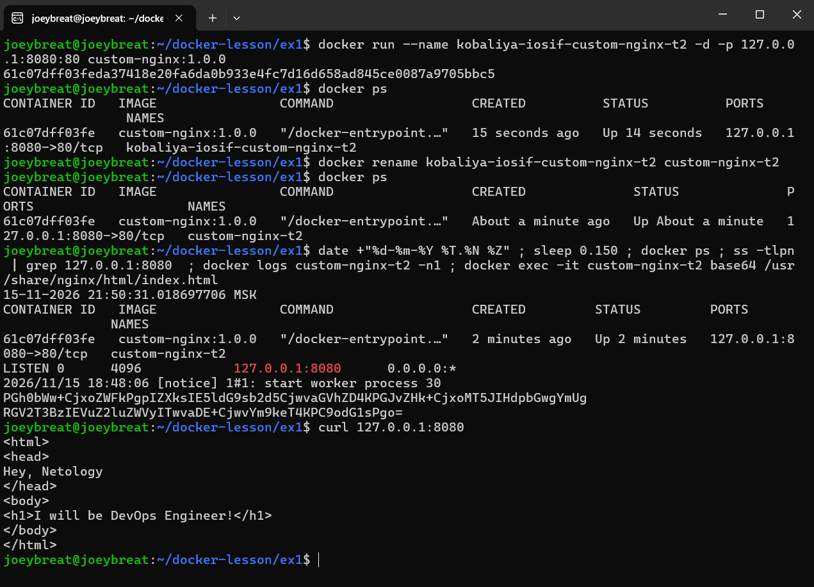

### Задание 3

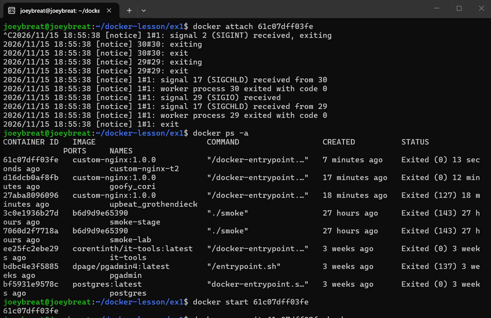

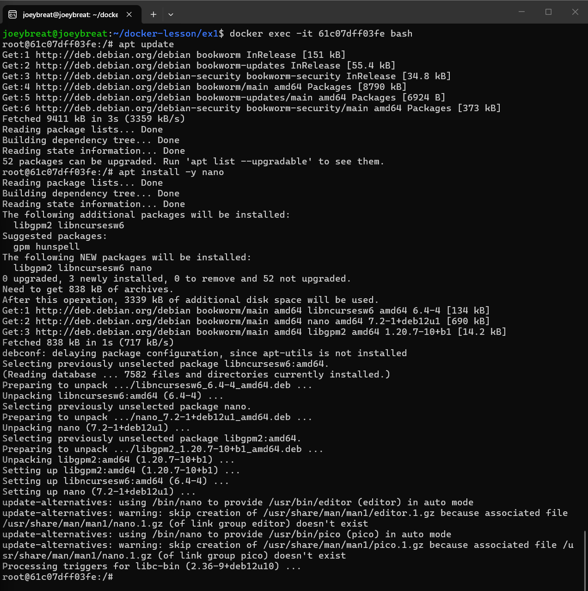

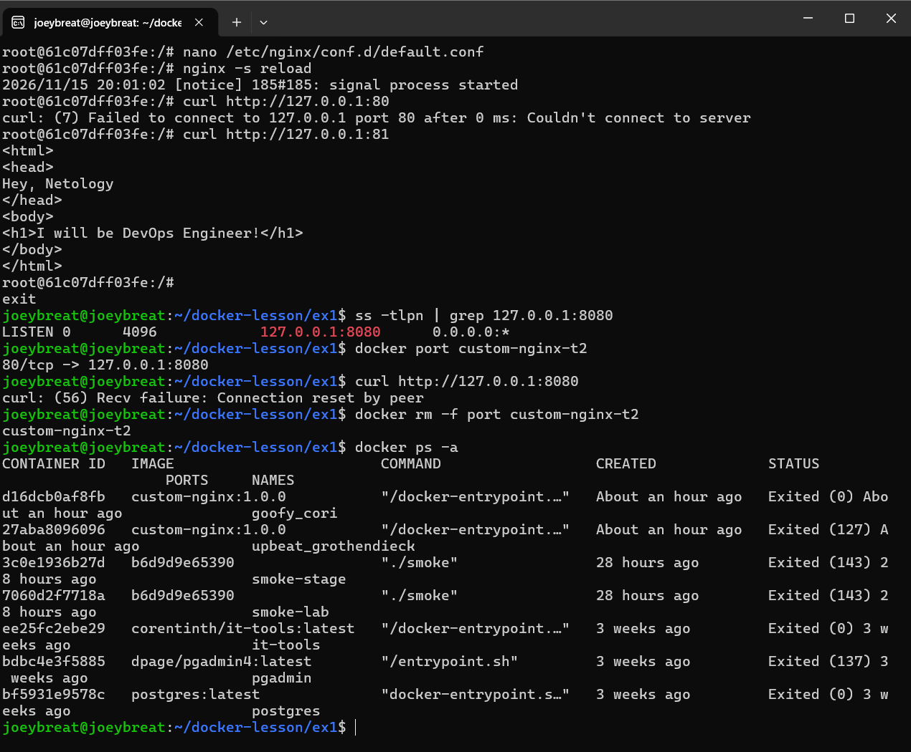

### Задание 4

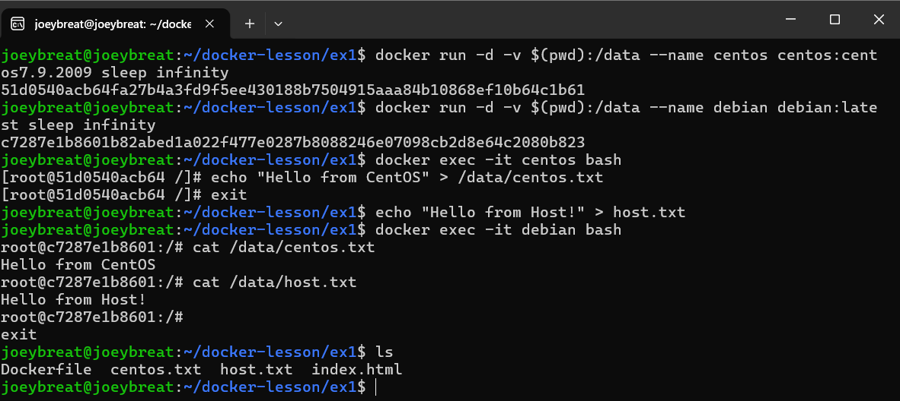

### Задание 5

1. Был запущен compose.yaml т.к. он является предпочтительным файлом по умолчанию. docker-compose.yaml и docker-compose.yml поддерживаются лишь для обратной совместимости

2. include позволяет интегрировать отдельный compose.yaml файл в свой текущий compose.yaml.

   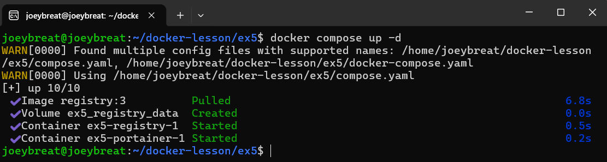

3. 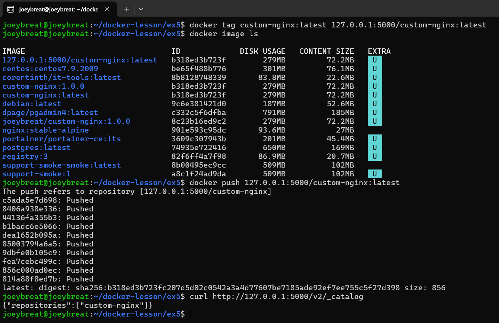

4. 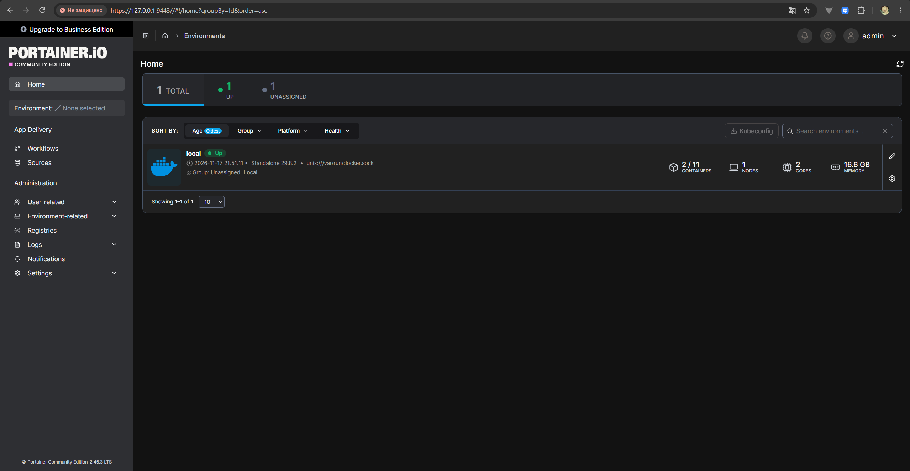

5. 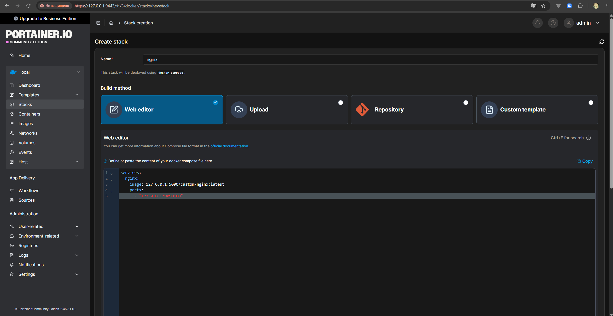
   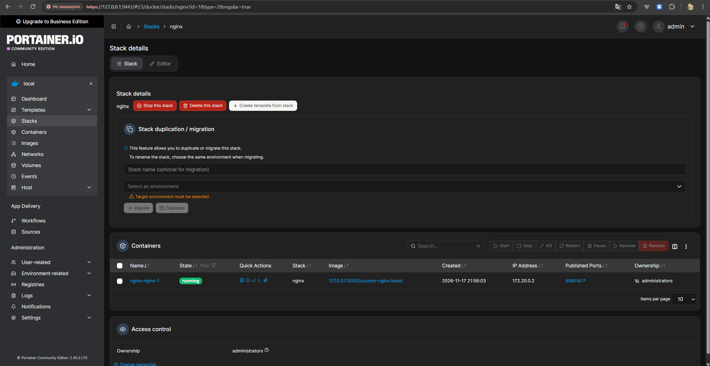
   

6. 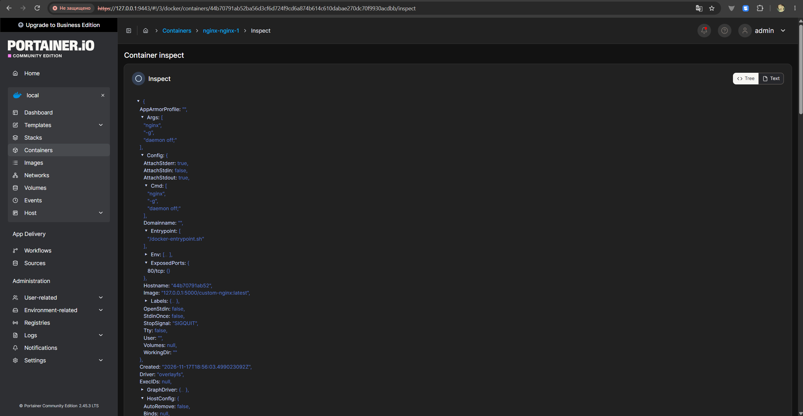

7. 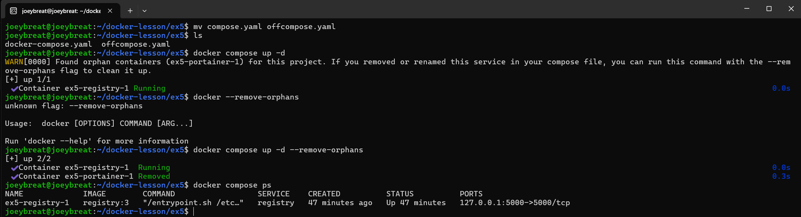

